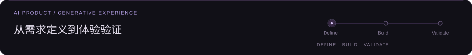
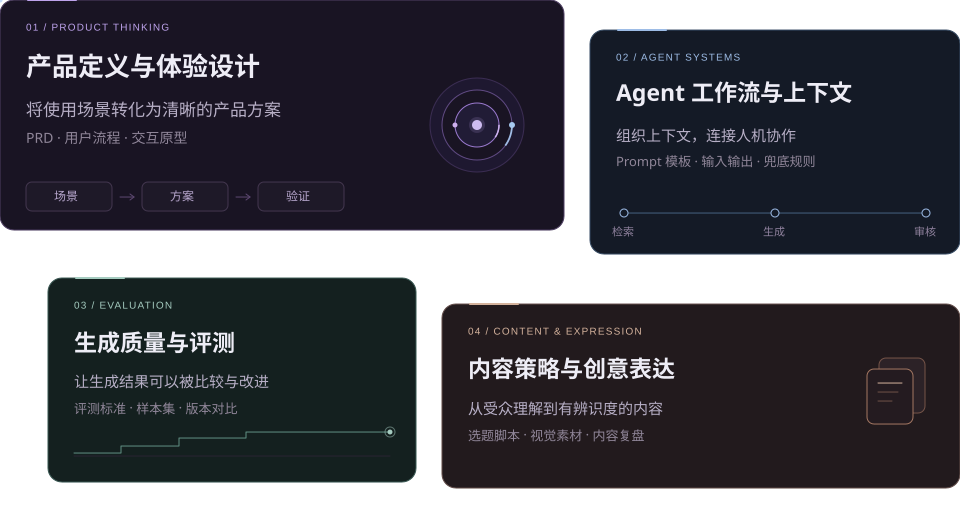

### AI 产品与生成体验

<picture>
  <source media="(prefers-reduced-motion: reduce) and (max-width: 460px)" srcset="./assets/signature-mobile-static.svg" />
  <source media="(prefers-reduced-motion: reduce)" srcset="./assets/signature-static.svg" />
  <source media="(max-width: 460px)" srcset="./assets/signature-mobile.svg" />
  
</picture>

围绕 AI 产品的需求定义、流程设计与效果验证，形成清晰的产品方案。 
以人机协作和结构化评测支持生成体验迭代，关注流程可用性与结果质量。

[个人网站](https://yan-shuang.github.io/) · [联系我](mailto:3233654978@qq.com)

### 核心能力与交付

<picture>
  <source media="(prefers-reduced-motion: reduce) and (max-width: 460px)" srcset="./assets/capabilities-mobile-static.svg" />
  <source media="(prefers-reduced-motion: reduce) and (max-width: 950px)" srcset="./assets/capabilities-tablet-static.svg" />
  <source media="(prefers-reduced-motion: reduce)" srcset="./assets/capabilities-static.svg" />
  <source media="(max-width: 460px)" srcset="./assets/capabilities-mobile.svg" />
  <source media="(max-width: 950px)" srcset="./assets/capabilities-tablet.svg" />
  
</picture>

展开能力与交付说明

**产品定义与体验设计** · 从使用场景和反馈中梳理需求，明确优先级，设计正常流程与异常状态。

**可以产出**：需求文档（PRD）、用户流程图、交互原型、任务拆解与验收清单。

**Agent 工作流与上下文** · 拆解资料配置、知识检索、内容生成、人工审核与反馈环节，组织上下文、示例和结构化输出要求。

**可以协助产出**：Agent 流程图、输入输出字段、Prompt 模板、人工介入与异常兜底规则。

**生成质量与评测迭代** · 围绕准确性、相关性、风格与可执行性评估结果，整理好坏案例、归纳错误类型，并对比 Prompt 版本。

**可以产出**：评测标准、基准样本集、问题分类表、版本对比与回归评测记录。

**内容策略与创意表达** · 根据受众和账号定位策划选题、撰写脚本，跟踪内容反馈；使用 Photoshop、Illustrator、Premiere 等工具辅助制作。

**可以产出**：选题清单、口播脚本、内容排期、视觉素材与内容复盘。

---

**从需求到方案，从生成到验证。**

[3233654978@qq.com](mailto:3233654978@qq.com) · [Yan-Shuang](https://github.com/Yan-Shuang)
